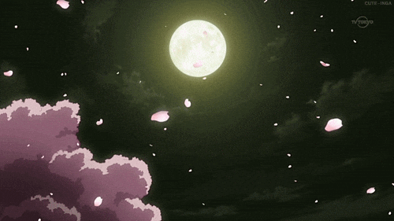
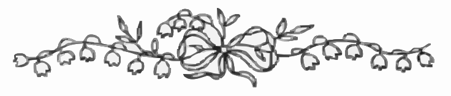
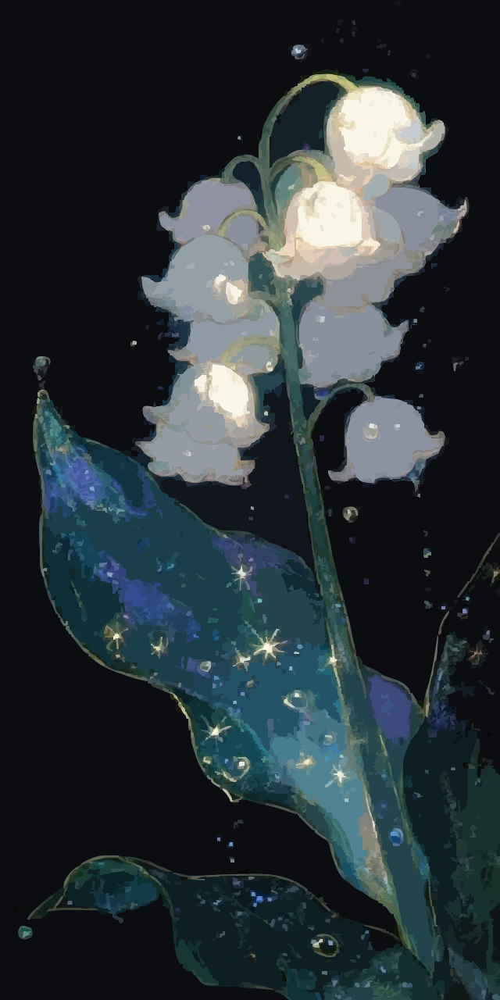

  

  <a href="#a-letter-about-me">open the letter</a>　✦　<a href="#little-things-i-love">wander the garden</a>　✦　<a href="#dreams-in-progress">peek at my little worlds</a>

  <i>“Somewhere between the things I dream and the things I make, I leave a little light on.”</i>

  

## ❦ A Letter About Me

  

Hello, wandering soul. 🌙

I'm **AoXink**, a dreamer who likes making things, collecting little wonders, and wandering through stories that feel a little like dreams.

This small corner of GitHub is my moonlit diary: part personal garden, part scrapbook, part workbench. You'll find fragments of what I'm learning, things I love, and little experiments left here to grow.

- **Currently learning:** English
- **Often found with:** VALORANT
- **A little dream of mine:** travelling to China

<a href="#the-last-page">turn to the last page ↓</a>

## ✧ Little Things I Love

  <i>small things, kept close</i>

| ❀ | A little corner of my world |
|:--:|:--|
| ♡ | **Flowers** — lily of the valley, pressed petals, quiet gardens |
| ♡ | **Stories** — games and dreamlike fictional worlds |
| ♡ | **Sounds** — the dreAMEE album |
| ♡ | **Little rituals** — VALORANT and silly moments with friends |
| ♡ | **Aesthetic treasures** — antique letters, moonlit skies, lavender and silver |

<i>“I have loved the stars too fondly to be fearful of the night.”</i> — Sarah Williams, <i>The Old Astronomer</i>

## ☾ Dreams in Progress

Not every little world is finished. Some are still sketches in the margin.

- **Now growing:** a cute Discord bot for my server
- **On the bookshelf:** learning Chinese and calligraphy
- **Someday, perhaps:** a cute, chill game with soft music

I write code because I like turning an idea into something that can exist beyond my imagination. The process is rarely as tidy as the final page, and that's part of the story too.

## ✉ The Little Things I Make

This isn't a portfolio carved in stone — just a few small worlds I happen to leave public. If something catches your eye, feel free to wander through it.

  <a href="https://github.com/ImAo?tab=repositories">✧ browse my worlds ✧</a>

## 🌙 Until the Next Moon

  

  <i>May you find wonder in ordinary days, 
  and leave a little stardust wherever you go.</i>

<b>— ʚ Augenstern ɞ —</b>

  <a href="#top">return to the beginning ↑</a>

✦ this little universe is always a work in progress ✦

